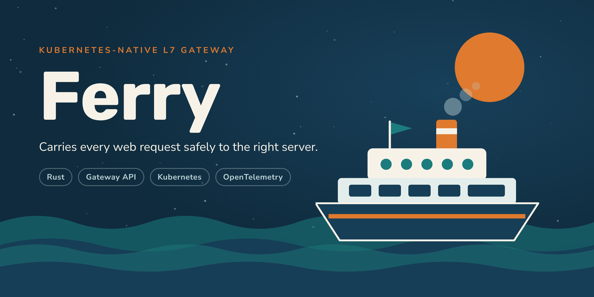

<p align="center">
  
</p>

A Kubernetes-native Layer 7 load balancer and API gateway, written in Rust.

Ferry terminates TLS and proxies HTTP/1.1, HTTP/2, gRPC and WebSockets to backend
pods. It is configured through the Kubernetes Gateway API and runs on AWS EKS
behind a Network Load Balancer.

> **Status: M5 (hardening) complete; next is M6, a production beta on EKS.**
> A Gateway API controller that passes the core conformance suite for
> HTTPRoute and GRPCRoute (plus 19 extended HTTPRoute tests), provisions a
> proxy fleet per Gateway and streams validated snapshots to it over mutual
> TLS; a `FerryPolicy` CRD; a Helm chart with alerting rules, runbooks and
> NetworkPolicies; and a one-command EKS staging bring-up
> ([`deploy/eks/up.sh`](deploy/eks/up.sh)). Underneath: TLS termination (SNI,
> hot certificate rotation) and upstream mTLS; HTTP/1.1, HTTP/2, gRPC and
> WebSocket proxying; Gateway API matching and filters; five load-balancing
> policies; health checks and outlier ejection; timeouts, budgeted retries,
> circuit breakers, rate limits and connection caps; PROXY protocol; request
> limits and HTTP/2 attack defences; zero-drop rolling restarts; Prometheus
> metrics, OpenTelemetry tracing, JSON access logs, an admin API and a
> Grafana dashboard. Every parser is fuzzed; releases are multi-arch, signed
> and ship an SBOM. See [`CLAUDE.md`](CLAUDE.md) for milestone status.


## Contents

- [Choose a setup path](#choose-a-setup-path)
- [Prerequisites](#prerequisites)
- [Option A: without AWS (free, local)](#option-a-without-aws-free-local)
  - [A1. Run the proxy on your machine](#a1-run-the-proxy-on-your-machine)
  - [A2. Build and test](#a2-build-and-test)
  - [A3. Local observability stack](#a3-local-observability-stack)
  - [A4. Kubernetes on kind](#a4-kubernetes-on-kind)
- [Option B: with AWS (EKS, paid)](#option-b-with-aws-eks-paid)
  - [Cost](#cost)
  - [B1. Account and tools](#b1-account-and-tools)
  - [B2. Build the Linux binary](#b2-build-the-linux-binary)
  - [B3. Bring up the cluster](#b3-bring-up-the-cluster)
  - [B4. Route traffic and look around](#b4-route-traffic-and-look-around)
  - [B5. Tear down](#b5-tear-down)
- [Configuration](#configuration)
- [Observability](#observability)
- [Operations and security](#operations-and-security)
- [Troubleshooting](#troubleshooting)
- [Repository layout](#repository-layout)
- [Development](#development)

## Choose a setup path

| | **Option A: no AWS** | **Option B: AWS EKS** |
| --- | --- | --- |
| Cost | Free | **Paid AWS account required**, about **$0.50 per hour** (≈ $12/day, ≈ $360/month if left running) |
| Needs | Rust, Docker | Everything in A, plus an AWS account, AWS CLI, eksctl, kubectl, helm |
| What you get | Ferry as a standalone proxy; tests, benchmarks and fuzzing; the observability stack in Docker; the full controller, Helm chart and Gateway API conformance suite on a local kind cluster | A real 3-node EKS cluster, an internet-facing AWS NLB with PROXY protocol v2, Ferry's image in ECR, Prometheus and Grafana with the Ferry dashboard and alerts |
| Time | 5 minutes (A1) to 30 minutes (A4) | 30-40 minutes, mostly waiting on CloudFormation |

Everything except the AWS-specific pieces (NLB, ECR, IAM roles for service
accounts) can be exercised with Option A. Start there even if you plan to use
AWS: the kind cluster runs the same chart and the same controller.

## Prerequisites

Common to both options:

| Tool | Version | Why | Install |
| --- | --- | --- | --- |
| Git | any | Clone the repo | `brew install git`, `apt install git` |
| Rust (rustup) | toolchain pinned to **1.99.0** in [`rust-toolchain.toml`](rust-toolchain.toml); rustup installs it on first build | Build Ferry | <https://rustup.rs> |
| C toolchain / linker | any | Linking (jemalloc, ring) | macOS: `xcode-select --install`; Debian/Ubuntu: `apt install build-essential pkg-config` |
| Docker | Docker Desktop, or Docker Engine 24+ | Linux builds, observability stack, kind, image builds | <https://docs.docker.com/get-docker/> |

Optional, for development:

```sh
cargo install --locked cargo-nextest cargo-deny cargo-audit cargo-llvm-cov
brew install k6        # or: docker run grafana/k6 (see bench/README.md)
```

No `protoc` is needed: protobuf code is generated in pure Rust (ADR 0003).

Clone the repo:

```sh
git clone https://github.com/ashmit27j/ferry.git
cd ferry
```

---

## Option A: without AWS (free, local)

### A1. Run the proxy on your machine

Three terminals, from the repo root:

```sh
# 1. A mock backend (HTTP on 9001)
cargo run -p ferry-testkit --bin mock-backend -- --name hello --http 127.0.0.1:9001

# 2. The proxy, listening on 8080 (admin API on 9901)
cargo run -p ferry -- proxy --config examples/hello.yaml

# 3. A request
curl -s http://127.0.0.1:8080/hello
# {"backend":"hello","method":"GET","path":"/hello",...}
```

The first build takes a few minutes. Then try:

- **Hot reload.** Edit `examples/hello.yaml` while the proxy runs; it reloads
  within a second. An invalid edit is logged and ignored, and the old config
  keeps serving.
- **Load balancing.** Start a second backend
  (`--name hello2 --http 127.0.0.1:9002`), add `127.0.0.1:9002` to the
  cluster's `endpoints`, and repeat the `curl`: responses alternate between
  `hello` and `hello2`.
- **Admin API.** `curl -s localhost:9901/clusters` shows endpoint health and
  load; `curl -s localhost:9901/metrics` shows Prometheus metrics.
- **Every option.** [`examples/gateway.yaml`](examples/gateway.yaml) covers
  routing, balancing and health checks; [`examples/edge.yaml`](examples/edge.yaml)
  covers TLS, limits and resilience.

Validate a config without running it, or print its JSON Schema for your editor:

```sh
cargo run -p ferry -- check-config examples/hello.yaml
cargo run -p ferry -- check-config --output json --print examples/hello.yaml
cargo run -p ferry -- check-config --schema > ferry.schema.json
```

The mock backend also speaks gRPC and WebSockets
(`--grpc 127.0.0.1:9101 --ws 127.0.0.1:9201`) and honours
`x-mock-latency-ms` and `x-mock-status` request headers, which makes it easy to
watch retries, timeouts and outlier ejection happen.

### A2. Build and test

```sh
cargo build --workspace
cargo nextest run --workspace        # unit, property, integration and e2e tests
cargo test --doc --workspace         # doctests
cargo clippy --workspace --all-targets --locked -- -D warnings
cargo fmt --all
cargo bench -p ferry-bench           # criterion micro-benchmarks
```

CI runs fmt, clippy, nextest, `cargo deny` and `cargo audit`; all must pass
before a commit. Fuzzing every parser needs nightly and cargo-fuzz, or Docker:

```sh
FUZZ_SECONDS=60 bench/exit/m5/fuzz.sh     # every fuzz target in a nightly container
```

### A3. Local observability stack

Runs Ferry, three traced mock backends, an OpenTelemetry Collector, Tempo,
Prometheus and Grafana in Docker, drives load with k6, kills a backend, and
checks every dashboard panel and a trace end to end.

1. Build Linux release binaries into a Docker volume (not into `./target`):

   ```sh
   docker run --rm -v "$PWD:/src" -v ferry-target:/target \
     -v ferry-cargo:/usr/local/cargo/registry -e CARGO_TARGET_DIR=/target -w /src \
     rust:1.99.0-bookworm cargo build --release --locked -p ferry -p ferry-testkit --bins
   ```

   On Windows with Git Bash, prefix it with `MSYS_NO_PATHCONV=1`.

2. Run the stack (needs Python 3 for the checks):

   ```sh
   bench/exit/run-m3.sh        # leaves the stack running; KEEP=0 tears it down
   ```

3. Open <http://localhost:3000> (anonymous admin) and the **Ferry** dashboard;
   Prometheus is on <http://localhost:9090>. Trace IDs to look up in Grafana's
   Explore view (Tempo) are in `bench/exit/results/m3-trace-ids.txt`.

See [`deploy/observability`](deploy/observability/README.md) for what each
container does.

### A4. Kubernetes on kind

The whole Kubernetes path (CRDs, controller, certgen, GatewayClass, a
Gateway, a proxy fleet, MetalLB for `LoadBalancer` addresses) on a local
[kind](https://kind.sigs.k8s.io) cluster. Only Docker is required: kind,
kubectl, helm and the Gateway API conformance suite run inside a runner
container ([`bench/exit/m4/runner.Dockerfile`](bench/exit/m4/runner.Dockerfile)).

Give Docker at least 4 CPUs and 8 GB of memory.

```sh
FRESH=1 bench/exit/run-m4.sh                         # cluster, helm install, smoke test, core conformance
EXTENDED=1 PHASES=conformance bench/exit/run-m4.sh   # also the extended HTTPRoute features
PHASES=smoke bench/exit/run-m4.sh                    # rerun the smoke test on the same cluster
KEEP=0 PHASES=smoke bench/exit/run-m4.sh             # ... and delete the cluster afterwards
```

The first run builds the Ferry image and the runner image (10-20 minutes);
results land in `bench/exit/results/m4-*`. The smoke test deploys an echo
backend with an HTTPRoute and a FerryPolicy and sends requests through the
Gateway.

To explore the cluster yourself, install `kind`, `kubectl` and `helm` on the
host (`brew install kind kubectl helm`), then:

```sh
kind export kubeconfig --name ferry-m4
kubectl get gatewayclass,gateway -A
kubectl -n ferry-system get pods                          # controller x2, proxy fleet
kubectl -n smoke get httproute smoke -o yaml              # status.parents shows Accepted/ResolvedRefs

# The MetalLB address is reachable from Linux hosts; on macOS and Windows,
# port-forward the fleet's Service instead:
kubectl -n ferry-system port-forward svc/ferry-ferry-system-ferry 8080:80
curl -s -H 'Host: smoke.example' http://127.0.0.1:8080/smoke/hello
```

Delete the cluster with `kind delete cluster --name ferry-m4`.

> On Apple Silicon the runner image downloads `linux/amd64` tools; Docker
> Desktop runs them under emulation (Settings > General > "Use Rosetta for
> x86_64/amd64 emulation").

To install the chart on any other cluster you already have (minikube, k3d,
Docker Desktop's Kubernetes), build and load the image and add the kind
values, which turn off the NLB annotations and PROXY protocol:

```sh
docker build -t ferry:dev .
helm install ferry deploy/helm/ferry -n ferry-system --create-namespace \
  -f deploy/helm/ferry/values-kind.yaml
```

---

## Option B: with AWS (EKS, paid)

> [!WARNING]
> **This option needs a paid AWS account and costs real money while the
> cluster exists.** The EKS control plane is never free, and an account on
> the AWS Free plan cannot run this setup: upgrade to a paid plan first.
> Free-plan credits, if you still have them, offset part of the bill but do
> not replace a paid account. Set a budget alert before you start, and tear
> everything down when you are done ([B5](#b5-tear-down)).

### Cost

What [`deploy/eks/up.sh`](deploy/eks/up.sh) creates, at on-demand list prices
in **us-east-1** at the time of writing (check the
[AWS Pricing Calculator](https://calculator.aws/) for your region):

| Resource | Quantity | Per hour | Per month (730 h) |
| --- | --- | --- | --- |
| EKS control plane (standard support) | 1 cluster | $0.10 | $73 |
| EC2 `m7i-flex.large` nodes (2 vCPU, 8 GiB) | 3 | $0.29 | $210 |
| EBS gp3 root volumes, 30 GiB each | 90 GiB | $0.01 | $7 |
| NAT gateway (eksctl default, single) | 1 | $0.045 + $0.045/GB | $33 + data |
| Network Load Balancer (the Gateway) | 1 | $0.0225 + LCUs | $16 + LCUs |
| Public IPv4 addresses (nodes, NAT, NLB per zone) | ~7 | $0.035 | $26 |
| ECR storage (one image, ~30 MB) | < 1 GB | — | < $0.10 |
| **Total** | | **≈ $0.50** | **≈ $365** |

Rules of thumb: **an afternoon of experimenting costs $2-5; a weekend left
running costs about $25; a forgotten month costs about $365.** Data transfer
out to the internet ($0.09/GB after the first 100 GB/month) and the HPA
scaling the node group to its maximum of 6 nodes would add to that. A
48-hour soak (the M6 staging run) is about $25.

### B1. Account and tools

1. **AWS account on a paid plan**, with an IAM user or SSO role that can
   create EKS clusters, EC2 instances, VPCs, IAM roles, CloudFormation
   stacks, ECR repositories and load balancers. `AdministratorAccess` in a
   sandbox account is simplest; see the
   [eksctl IAM policies](https://eksctl.io/usage/minimum-iam-policies/) for a
   narrower set.
2. **Service quotas**: at least 6 vCPUs of "Running On-Demand Standard
   instances" in the region (new accounts sometimes start lower; request an
   increase in the Service Quotas console), and a free Elastic IP.
3. **A budget alert**: Billing console > Budgets > create a monthly cost
   budget (for example $20) with an email alert.
4. **Tools** on your machine, in addition to [the common ones](#prerequisites):

   | Tool | Install (macOS) | Other platforms |
   | --- | --- | --- |
   | AWS CLI v2 | `brew install awscli` | <https://docs.aws.amazon.com/cli/latest/userguide/getting-started-install.html> |
   | eksctl | `brew install eksctl` | <https://eksctl.io/installation/> |
   | kubectl | `brew install kubectl` | <https://kubernetes.io/docs/tasks/tools/> |
   | helm 3 | `brew install helm` | <https://helm.sh/docs/intro/install/> |
   | envsubst | `brew install gettext` | `apt install gettext-base` |

5. **Credentials**:

   ```sh
   aws configure                      # or: aws configure sso && export AWS_PROFILE=...
   aws sts get-caller-identity        # must print your account ID
   ```

### B2. Build the Linux binary

`up.sh` packages a prebuilt `linux/amd64` binary from the `ferry-target`
Docker volume into a distroless image
([`deploy/eks/Dockerfile.prebuilt`](deploy/eks/Dockerfile.prebuilt)), so the
release build happens once:

```sh
docker run --rm -v "$PWD:/src" -v ferry-target:/target \
  -v ferry-cargo:/usr/local/cargo/registry -e CARGO_TARGET_DIR=/target -w /src \
  rust:1.99.0-bookworm cargo build --release --locked -p ferry -p ferry-testkit --bins
```

> **Apple Silicon (and other arm64 hosts):** the nodes are x86_64, so run
> `export DOCKER_DEFAULT_PLATFORM=linux/amd64` in the shell before this build
> and before `up.sh`. The build then runs under emulation and is slower
> (expect 20-40 minutes). If the volume already holds an arm64 build, remove
> it first with `docker volume rm ferry-target`.

### B3. Bring up the cluster

```sh
CLUSTER=ferry-staging REGION=us-east-1 deploy/eks/up.sh
```

It runs five steps, each safe to rerun:

| Step | What happens | Time |
| --- | --- | --- |
| `cluster` | `eksctl create cluster` from [`deploy/eks/cluster.yaml`](deploy/eks/cluster.yaml): a VPC across three zones, three `m7i-flex.large` nodes (scales to 6), OIDC for IAM roles for service accounts, the VPC CNI with NetworkPolicy enforcement, and an IAM role for the load balancer controller | 15-20 min |
| `lbc` | The AWS Load Balancer Controller (Helm), which turns Ferry's `LoadBalancer` Services into NLBs with IP targets | 1-2 min |
| `monitoring` | kube-prometheus-stack (Prometheus, Alertmanager, Grafana) with the Ferry dashboard loaded | 3-5 min |
| `image` | Creates the `ferry` ECR repository (scan on push) and pushes the image, tagged with the current commit | 1-3 min |
| `ferry` | Installs the Ferry chart with [`deploy/eks/values-eks.yaml`](deploy/eks/values-eks.yaml): controller, GatewayClass, a Gateway named `ferry` on port 80, access logs, PodMonitors and alerting rules; then waits for the NLB address | 3-5 min |

When it finishes it prints the Gateway's NLB hostname. DNS for a new NLB can
take a few minutes to resolve. To rerun only some steps (for example after a
code change, rebuild the binary first):

```sh
STEPS="image ferry" deploy/eks/up.sh
```

### B4. Route traffic and look around

Until an HTTPRoute is attached, the Gateway answers 404. Deploy a sample app
and route to it:

```sh
kubectl create deployment echo --image=ealen/echo-server:latest --port=80
kubectl expose deployment echo --port=80
sed 's/my-service/echo/' deploy/eks/route.example.yaml | kubectl apply -f -

ADDR=$(kubectl -n ferry-system get gateway ferry -o jsonpath='{.status.addresses[0].value}')
curl -s "http://$ADDR/hello"
```

For your own Service, edit the namespace, name and port in
[`deploy/eks/route.example.yaml`](deploy/eks/route.example.yaml) and
`kubectl apply -f` it. Then:

```sh
kubectl get gateway -n ferry-system ferry                 # PROGRAMMED=True, ADDRESS=<nlb>
kubectl -n ferry-system get pods,svc,hpa,pdb              # controller x2, proxy fleet x3
kubectl -n ferry-system logs deploy/ferry-ferry-system-ferry | head   # JSON access logs

# Grafana, with the Ferry dashboard
kubectl -n monitoring port-forward svc/kube-prometheus-stack-grafana 3000:80
kubectl -n monitoring get secret kube-prometheus-stack-grafana \
  -o jsonpath='{.data.admin-password}' | base64 -d; echo   # user: admin
```

Tune load balancing, retries, outlier detection, circuit breakers or rate
limits per Service with a [`FerryPolicy`](#configuration).

### B5. Tear down

Delete the Gateway first, so the controller removes the proxy fleet and the
AWS Load Balancer Controller deletes the NLB. An NLB left behind keeps
billing and blocks deletion of the VPC.

```sh
kubectl -n ferry-system delete gateway ferry
kubectl -n ferry-system get svc -w        # wait until ferry-ferry-system-ferry is gone, then Ctrl-C

eksctl delete cluster --name ferry-staging --region us-east-1 --wait
aws ecr delete-repository --repository-name ferry --region us-east-1 --force
```

Then confirm nothing is left in the EC2 console (instances, load balancers,
NAT gateways, Elastic IPs, volumes) and in CloudFormation (no
`eksctl-ferry-staging-*` stacks). If a stack fails to delete, it is almost
always an orphaned load balancer or security group: delete it by hand and
retry the stack deletion.

---

## Configuration

### Standalone (YAML)

`ferry proxy --config <file>` reads one YAML file and reloads it on change.
The smallest useful config ([`examples/hello.yaml`](examples/hello.yaml)):

```yaml
listeners:
  - name: http
    address: 127.0.0.1:8080
    routes:
      - name: hello
        rules:
          - matches:
              - path: { type: PathPrefix, value: / }
            backends:
              - cluster: hello

clusters:
  - name: hello
    lb_policy: round_robin
    endpoints:
      - address: 127.0.0.1:9001
```

### Kubernetes (Gateway API)

The chart installs the controller (two replicas, leader-elected), the
`ferry` GatewayClass, the FerryPolicy and Gateway API CRDs, and a hook that
issues the certificates of the controller-to-proxy stream. Every Gateway of
class `ferry` gets its own proxy Deployment, PodDisruptionBudget, HPA and
`LoadBalancer` Service (an AWS NLB with IP targets and PROXY protocol v2 by
default); see the [chart README](deploy/helm/ferry/README.md) for every value.

```sh
helm install ferry deploy/helm/ferry -n ferry-system --create-namespace
```

Settings the Gateway API lacks attach with a `FerryPolicy`:

```yaml
apiVersion: gateway.ferry.dev/v1alpha1
kind: FerryPolicy
metadata: { name: api, namespace: shop }
spec:
  targetRefs: [{ group: "", kind: Service, name: api }]
  loadBalancer: { kind: P2cEwma }
  outlierDetection: { consecutive5xx: 5 }
  circuitBreakers: { maxRequests: 500 }
```

## Observability

The admin API listens on `127.0.0.1:9901` (`--admin-address`, or `off`):

```sh
curl -s localhost:9901/ready      # 200, or 503 once draining
curl -s localhost:9901/metrics    # Prometheus (OpenMetrics text)
curl -s localhost:9901/clusters   # endpoint health, ejection, load, pools
curl -s localhost:9901/config     # active config, private keys redacted
```

JSON access logs: `--access-log stdout` (or a path). Traces: set
`--otlp-endpoint http://collector:4317` (or `OTEL_EXPORTER_OTLP_ENDPOINT`);
Ferry continues incoming W3C `traceparent` headers and adds a span per
upstream attempt. Diagnostic logs: `FERRY_LOG` takes an `EnvFilter` (default
`info`), and `--log-format json` switches to JSON lines. The Grafana
dashboard is [`deploy/grafana/ferry-dashboard.json`](deploy/grafana/ferry-dashboard.json),
SLOs first; [A3](#a3-local-observability-stack) runs it locally and
[B3](#b3-bring-up-the-cluster) installs it on EKS.

## Operations and security

- **Alerts.** The chart installs a PrometheusRule
  ([`files/alerts.yaml`](deploy/helm/ferry/files/alerts.yaml)): SLO
  burn-rate 5xx, ejected or missing backends, certificate expiry, rejected
  configs, and a lost or down controller. Each alert links to a runbook in
  [`docs/runbooks`](docs/runbooks/README.md).
- **Certificates.** The certgen hook renews the controller-to-proxy
  certificates on `helm upgrade` within 90 days of expiry; restart the
  controller and proxies afterwards
  (`kubectl -n ferry-system rollout restart deployment`).
- **Security.** [`SECURITY.md`](SECURITY.md) covers reporting and release
  verification; [`docs/security/threat-model.md`](docs/security/threat-model.md)
  covers trust boundaries, mitigations and accepted risks.
- **Releases.** Merging the release-please PR publishes
  `ghcr.io/ashmit27j/ferry` (linux/amd64 and linux/arm64) and the Helm chart
  as an OCI artifact, both signed with Cosign keyless signing, with an SPDX
  SBOM and SLSA provenance.

```sh
cosign verify ghcr.io/ashmit27j/ferry:1.0.0 \
  --certificate-identity https://github.com/ashmit27j/ferry/.github/workflows/release.yml@refs/heads/main \
  --certificate-oidc-issuer https://token.actions.githubusercontent.com
```

## Troubleshooting

| Symptom | Cause and fix |
| --- | --- |
| `Address already in use` on 8080 or 9901 | Another Ferry is running. Stop it, or pass `--admin-address off` / change the listener address. |
| `curl` to the proxy returns 503 | No healthy endpoint: the mock backend is not running on the configured port. `curl localhost:9901/clusters` shows health. |
| Linker errors or "No space left on device" during builds | The disk is full; `cargo clean --profile dev`. |
| `run-m3.sh` / `run-m4.sh` fail early | Docker is not running, has too little memory (give it 8 GB), or the `ferry-target` volume is empty (build step in A3). |
| Gateway on kind not reachable from macOS | MetalLB addresses live on the Docker network; use `kubectl port-forward` as in A4. |
| `eksctl` fails with `UnsupportedAvailabilityZoneException` or quota errors | Pick another region, or raise the On-Demand vCPU quota (B1). |
| `exec format error` in proxy pods on EKS | The image holds an arm64 binary. Rebuild with `DOCKER_DEFAULT_PLATFORM=linux/amd64` (B2) and `STEPS="image ferry" deploy/eks/up.sh`. |
| Gateway on EKS has no address | The AWS Load Balancer Controller is not running: `kubectl -n kube-system get deploy aws-load-balancer-controller`, then `STEPS=lbc deploy/eks/up.sh`. |
| Requests to the NLB hang or reset | PROXY protocol mismatch: the chart's `proxy.proxyProtocol` and the NLB annotation must agree (both on by default). |
| Grafana shows no Ferry data | The PodMonitors are missing: install kube-prometheus-stack before Ferry, or rerun `STEPS=ferry deploy/eks/up.sh`. |

## Repository layout

| Path | What |
| --- | --- |
| `bin/ferry` | Single binary: `proxy`, `controller`, `certgen`, `crds`, `check-config` |
| `crates/ferry-config` | Config model, validation, immutable snapshots |
| `crates/ferry-lb` | Balancers, health checks, upstream connection pools |
| `crates/ferry-proxy` | Listeners, router, forwarding, hot swap, drain |
| `crates/ferry-controller` | Gateway API controller: translator, status, provisioning, snapshot server |
| `crates/ferry-api` | Protobuf + gRPC for controller → proxy snapshots |
| `crates/ferry-telemetry` | Metrics, tracing, access logs, logging |
| `crates/ferry-testkit` | Mock HTTP/h2c/gRPC/WebSocket backends, trace client, WebSocket flood |
| `tests/` | In-process integration tests |
| `fuzz/` | cargo-fuzz targets for every parser (six, nightly in CI) |
| `bench/` | criterion, k6, exit tests, [results](bench/RESULTS.md) |
| `deploy/helm/ferry` | Helm chart |
| `deploy/eks` | EKS staging bring-up: eksctl config, `up.sh`, values, sample HTTPRoute |
| `deploy/grafana`, `deploy/observability` | Grafana dashboard, local observability stack |
| `docs/adr/` | Architecture decision records (0001-0037) |
| `docs/runbooks/`, `docs/security/` | Runbook per alert, threat model |

## Development

See [`CLAUDE.md`](CLAUDE.md) for commands and conventions, and
[`DESIGN.md`](DESIGN.md) for the visual design system used by the dashboard and docs.
Commits follow [Conventional Commits](https://www.conventionalcommits.org)
(`feat(lb): ...`, `fix(proxy): ...`); fmt, clippy, nextest, `cargo deny` and
`cargo audit` must pass before every commit.

## License

[Apache License 2.0](LICENSE).
