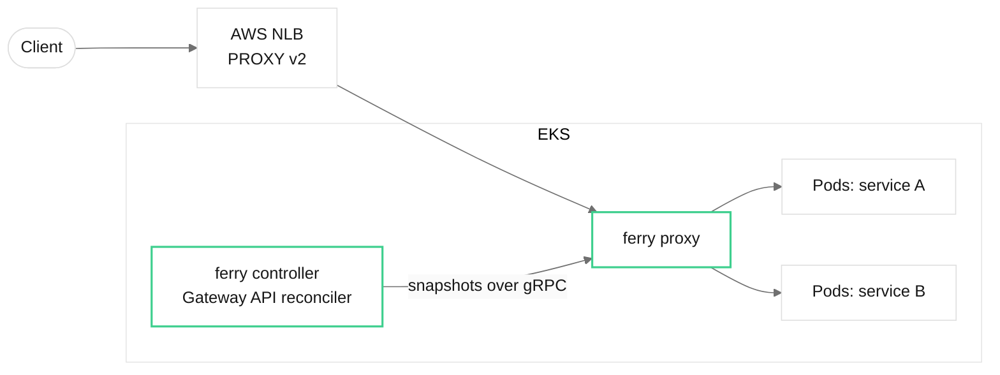

# Ferry

A Kubernetes-native Layer 7 load balancer and API gateway, written in Rust.

Ferry terminates TLS and proxies HTTP/1.1, HTTP/2, gRPC and WebSockets to backend
pods. It is configured through the Kubernetes Gateway API and runs on AWS EKS
behind a Network Load Balancer.

> **Status: M5 (hardening) complete; next is M6, a production beta on EKS.**
> A Gateway API controller that passes the core conformance suite for
> HTTPRoute and GRPCRoute (plus 19 extended HTTPRoute tests), provisions a
> proxy fleet per Gateway and streams validated snapshots to it over mutual
> TLS; a `FerryPolicy` CRD; a Helm chart with alerting rules, runbooks and
> NetworkPolicies. Underneath: TLS termination (SNI, hot certificate
> rotation) and upstream mTLS; HTTP/1.1, HTTP/2, gRPC and WebSocket proxying;
> Gateway API matching and filters; five load-balancing policies; health
> checks and outlier ejection; timeouts, budgeted retries, circuit breakers,
> rate limits and connection caps; PROXY protocol; request limits and HTTP/2
> attack defences; zero-drop rolling restarts; Prometheus metrics,
> OpenTelemetry tracing, JSON access logs, an admin API and a Grafana
> dashboard. Every parser is fuzzed; releases are multi-arch, signed and
> ship an SBOM. See [`CLAUDE.md`](CLAUDE.md) for milestone status.



## Quick start

```sh
# 1. A mock backend
cargo run -p ferry-testkit --bin mock-backend -- --name hello --http 127.0.0.1:9001

# 2. The proxy
cargo run -p ferry -- proxy --config examples/hello.yaml

# 3. A request
curl -s http://127.0.0.1:8080/hello
# {"backend":"hello","method":"GET","path":"/hello",...}
```

Edit `examples/hello.yaml` while the proxy runs and it reloads within a second;
an invalid edit is logged and ignored. [`examples/gateway.yaml`](examples/gateway.yaml)
shows every routing, balancing and health-check option, and
[`examples/edge.yaml`](examples/edge.yaml) every TLS, limit and resilience one.

Validate a config without running it, or print its JSON Schema:

```sh
cargo run -p ferry -- check-config examples/hello.yaml
cargo run -p ferry -- check-config --output json --print examples/hello.yaml
cargo run -p ferry -- check-config --schema > ferry.schema.json
```

## On Kubernetes

```sh
helm install ferry deploy/helm/ferry -n ferry-system --create-namespace
```

The chart installs the controller (two replicas, leader-elected), the
`ferry` GatewayClass, the FerryPolicy and Gateway API CRDs, and a hook that
issues the certificates of the controller-to-proxy stream. Every Gateway of
class `ferry` then gets its own proxy Deployment, PodDisruptionBudget, HPA and
`LoadBalancer` Service (an AWS NLB with IP targets and PROXY protocol v2 by
default); see the [chart README](deploy/helm/ferry/README.md).
[`bench/exit/run-m4.sh`](bench/exit/run-m4.sh) does all of it on a local kind
cluster and runs the Gateway API conformance suite.

Settings the Gateway API lacks attach with a `FerryPolicy`:

```yaml
apiVersion: gateway.ferry.dev/v1alpha1
kind: FerryPolicy
metadata: { name: api, namespace: shop }
spec:
  targetRefs: [{ group: "", kind: Service, name: api }]
  loadBalancer: { kind: P2cEwma }
  outlierDetection: { consecutive5xx: 5 }
  circuitBreakers: { maxRequests: 500 }
```

## Observability

The admin API listens on `127.0.0.1:9901` (`--admin-address`, or `off`):

```sh
curl -s localhost:9901/ready      # 200, or 503 once draining
curl -s localhost:9901/metrics    # Prometheus (OpenMetrics text)
curl -s localhost:9901/clusters   # endpoint health, ejection, load, pools
curl -s localhost:9901/config     # active config, private keys redacted
```

JSON access logs: `--access-log stdout` (or a path). Traces: set
`--otlp-endpoint http://collector:4317` (or `OTEL_EXPORTER_OTLP_ENDPOINT`);
Ferry continues incoming W3C `traceparent` headers and adds a span per
upstream attempt. The Grafana dashboard is
[`deploy/grafana/ferry-dashboard.json`](deploy/grafana/ferry-dashboard.json),
SLOs first. [`deploy/observability`](deploy/observability/README.md) runs the
whole stack (Prometheus, Grafana, OpenTelemetry Collector, Tempo) locally.

## Operations and security

- **Alerts.** The chart installs a PrometheusRule
  ([`files/alerts.yaml`](deploy/helm/ferry/files/alerts.yaml)): SLO
  burn-rate 5xx, ejected or missing backends, certificate expiry, rejected
  configs, and a lost or down controller. Each alert links to a runbook in
  [`docs/runbooks`](docs/runbooks/README.md).
- **Security.** [`SECURITY.md`](SECURITY.md) covers reporting and release
  verification; [`docs/security/threat-model.md`](docs/security/threat-model.md)
  covers trust boundaries, mitigations and accepted risks.
- **Releases.** Merging the release-please PR publishes
  `ghcr.io/ashmit27j/ferry` (linux/amd64 and linux/arm64) and the Helm chart
  as an OCI artifact, both signed with Cosign keyless signing, with an SPDX
  SBOM and SLSA provenance.

```sh
cosign verify ghcr.io/ashmit27j/ferry:1.0.0 \
  --certificate-identity https://github.com/ashmit27j/ferry/.github/workflows/release.yml@refs/heads/main \
  --certificate-oidc-issuer https://token.actions.githubusercontent.com
```

## Repository layout

| Path | What |
| --- | --- |
| `bin/ferry` | Single binary: `proxy`, `controller`, `certgen`, `crds`, `check-config` |
| `crates/ferry-config` | Config model, validation, immutable snapshots |
| `crates/ferry-lb` | Balancers, health checks, upstream connection pools |
| `crates/ferry-proxy` | Listeners, router, forwarding, hot swap, drain |
| `crates/ferry-controller` | Gateway API controller: translator, status, provisioning, snapshot server |
| `crates/ferry-api` | Protobuf + gRPC for controller → proxy snapshots |
| `crates/ferry-telemetry` | Metrics, tracing, access logs, logging |
| `crates/ferry-testkit` | Mock HTTP/h2c/gRPC/WebSocket backends, trace client, WebSocket flood |
| `tests/` | In-process integration tests |
| `fuzz/` | cargo-fuzz targets for every parser (six, nightly in CI) |
| `bench/` | criterion, k6, exit tests, [results](bench/RESULTS.md) |
| `deploy/` | Helm chart, Grafana dashboard, local observability stack |
| `docs/adr/` | Architecture decision records (0001-0037) |
| `docs/runbooks/`, `docs/security/` | Runbook per alert, threat model |

## Development

See [`CLAUDE.md`](CLAUDE.md) for commands and conventions, and
[`DESIGN.md`](DESIGN.md) for the visual design system used by the dashboard and docs.

## License

[Apache License 2.0](LICENSE).
